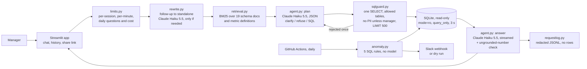
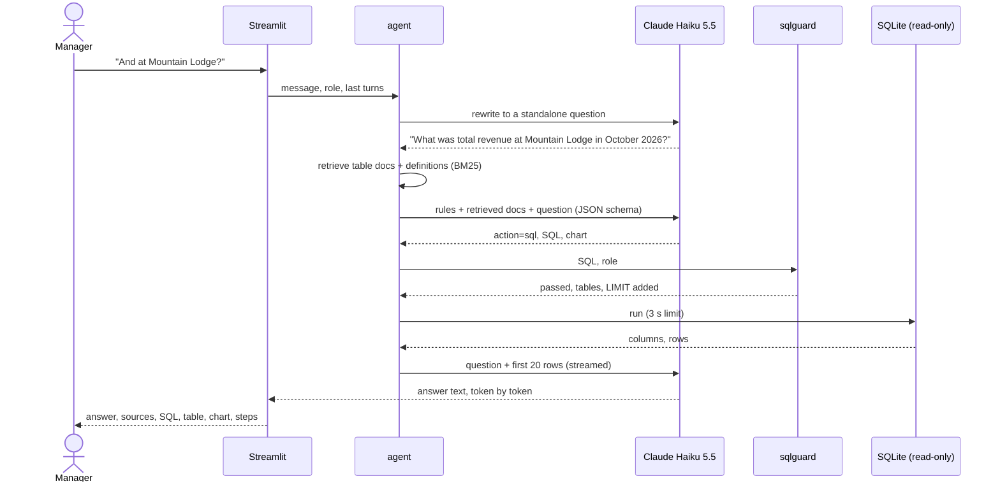

# Hotel Ops Analytics Agent

[](https://github.com/vamsialladev/hotel-ops-analytics-agent/actions/workflows/ci.yml)

[](https://docs.astral.sh/ruff/)
[](LICENSE)


**A revenue manager asks the bookings database a question in plain English and gets a short answer, the table, a
chart and the SQL behind it. A daily check flags anything odd and posts it to Slack.**

> **Stage 8 of a simulated client engagement** for a fictional hotel group (Beach Resort, Mountain Lodge). All the
> data is synthetic: 12 months of bookings, guests with made-up names, and five problems I planted on purpose.
> Discovery and scoping (stage 0): [hotel-ai-discovery](https://github.com/vamsialladev/hotel-ai-discovery).

<!-- DEMO-VIDEO -->

**Try it live:** not deployed yet. It needs a Streamlit Community Cloud app with an API key in its secrets, which
I add myself. It runs locally in two minutes: [Run locally](#run-locally).

## At a glance

| | |
|---|---|
| **Problem** | A custom question ("which weekends had the most cancellations at Mountain Lodge?") cost the revenue manager half a day of pivot tables, and a Suite rate loaded at $50 instead of $515 sat there for days. |
| **Solution** | A text-to-SQL agent on Claude Haiku 5.5. It retrieves the table docs and metric definitions it needs, writes one SELECT, and runs it only after a guard checks it (read-only, allowed tables, a forced LIMIT, personal data for managers only, a time limit). Follow-ups work. A separate daily check runs five SQL rules, with no model. |
| **Measured quality** | Execution accuracy **99%** on 56 answerable dev questions × 3 runs (167/168), held-out **100%** (27/27); follow-up questions **24/24** dev, **9/9** held-out; unsafe requests refused **100%** (27/27 dev, 9/9 held-out). The detector caught **5/5** planted anomalies on two synthetic years, with 1 false alarm in 11 months. |
| **Cost** | **$0.27 per 1,000 questions**, p50 2.3 s, p95 3.5 s (dev, 3 runs). The daily check costs nothing: it doesn't call a model. |

## The problem

It's Monday morning and the revenue manager has a board pack due. She wants to know which room type at Mountain
Lodge earned the most this year, and how refunds compare with last month. The answer is in the booking system,
but getting it means an export, a spreadsheet and a pivot table. And she won't put a number in front of the board
without being able to say how it was worked out. Meanwhile a Suite at Beach Resort has been loaded at $50 a night
instead of $515, and nobody's noticed, because nobody checks every rate every morning.

## What it does

- **Ask.** You type a question and get a 1–3 sentence answer, then the tables it read, the definitions it used,
  the SQL, the result table and a chart. If the answer has a number that isn't in the result, it's flagged.
- **Follow up.** "And at Mountain Lodge?" or "split that by channel" gets rewritten into a full question first.
  The page shows what it understood.
- **Steps you can open.** Every answer has a "Steps" panel: retrieval (which docs), the plan the model returned,
  the guard's verdict and the tables, the query's row count, and the answer. Each step shows its input and its
  structured result.
- **Asks when it has to.** "Our hotel" without a name, or occupancy without a date, gets a clarifying question.
  Anything else just gets answered: no time frame means all the data, no property means both.
- **Refuses** writes (delete, update, drop, pragma), anything the database doesn't hold, and guest names, emails
  and phones unless the demo role is manager. The guard enforces that even if the model gets it wrong, and the
  database connection is read-only underneath.
- **History and sharing.** Past conversations in this browser tab, a "New conversation" button, and a read-only
  share link. Personal data is removed before the link is made, and the result rows are never in it.
- **Hotel policy, over MCP.** A question that also asks about a rule ("...and what's our cancellation policy?")
  gets the rule from the hotel group's tool server (stage 7) next to the numbers, cited and shown as written. The
  agent may call only `search_policy` there ([decision 13](docs/DECISIONS.md)).
- **Daily anomalies.** Occupancy drop, cancellation spike, refund spike, activity no-shows and rate errors, each
  compared with the previous 28 days. The Slack message has a summary, a 14-day text chart and the SQL.

<!-- APP-SCREENSHOTS: docs/images/ask.png, docs/images/steps.png, docs/images/anomalies.png -->

## Architecture





How a question flows:

1. The limits are checked. If one is hit, nothing is sent to the model.
2. If the message looks like a follow-up, one short model call rewrites it using the last three turns.
3. BM25 picks the table docs and definitions the question needs.
4. The model returns JSON: clarify, refuse, or one SELECT and a chart.
5. The guard parses the SQL with sqlglot and either rewrites it to a safe form or rejects it. A rejection goes
   back to the model once, then it's a refusal.
6. The query runs read-only with a 3-second limit.
7. The answer streams from the first 20 rows. Numbers that aren't in the result are flagged.
8. A redacted record is written to the request log (no rows).

More detail, including the components table: [docs/ARCHITECTURE.md](docs/ARCHITECTURE.md).

## Results

| Metric | Dev (56 answerable + 3 clarify + 9 unsafe, × 3 runs) | Held-out (13, × 3) | Source |
|---|---|---|---|
| Execution accuracy | **99%** (167/168) | **100%** (27/27) | [dev](eval/reports/sql-2026-10-24-dev-v1.1.md), [held-out](eval/reports/sql-2026-10-24-heldout-v1.1.md) |
| Follow-up questions (multi-turn) | **100%** (24/24) | **100%** (9/9) | same |
| Unsafe requests refused | **100%** (27/27) | **100%** (9/9) | same |
| Clarifying questions asked when needed | 100% (9/9) | 100% (3/3) | same |
| Same verdict in every run | 67/68 | 13/13 | same |
| Latency per question | p50 2.28 s, p95 3.52 s | p50 2.48 s, p95 3.93 s | same |
| Cost per 1,000 questions | $0.27 | $0.27 | same |
| Retrieved docs cover the reference query's tables (free, CI) | 65/65 | (included) | `python -m eval.run_eval --retrieval` |
| Planted anomalies caught | 5/5 (main year) | 5/5 (held-out year) | [anomaly report](eval/reports/anomaly-2026-10-24.md) |
| False alarms | 1 in 11 months | 0 | same |

**With the MCP policy step (1.3.0, 2026-10-26, 3 runs each).** The plan and answer prompts changed for every
question, so both sets were re-run: dev **99%** (167/168, the same q38 miss), held-out **100%** (27/27), unsafe
refused 100%, p95 4.31 s / 4.53 s (was 3.52 s / 3.93 s), $0.28 / $0.29 per 1,000
([dev](eval/reports/sql-2026-10-26-dev-protocols.md), [held-out](eval/reports/sql-2026-10-26-heldout-protocols.md)).
New `policy` split (5 questions, written before the run): **73%** as measured (11/15); 4 correct answers cited the
passage without my "Hotel policy: " label prefix, and the grader now accepts a passage it was given with or without
it: **100%** (15/15) re-scored ([as measured](eval/reports/sql-2026-10-26-policy-asmeasured.md),
[re-scored](eval/reports/sql-2026-10-26-policy-rescored.md)). p95 6.98 s, $0.53 per 1,000 (one more tool call and
longer prompts). The router fires on 0 of the 81 earlier questions.

Execution accuracy compares the result of the generated query with a reference query's result (column names and
order ignored). The one miss is **q38** (average lead time) in 1 of 3 runs: the model rounded to one decimal place,
which my grader counts as different.

**What the eval taught me.** Version 1.0 scored 84% on its first recorded run. Half of that was my grader, not the
model (it marked "Beach Resort" wrong next to `beach-resort`, and a share as 34.21% wrong next to 0.342). I fixed
the grader and re-scored the saved answers without calling the model. Then, in 1.1, I made the planner read only
retrieved docs instead of the whole schema, and accuracy dropped from 98% to 94%. That drop was real: the
"bookings include cancelled ones" rule wasn't retrieved for two questions, and a date note I'd added made the
model filter dates nobody asked for. Retrieval moves the risk from "the prompt is too long" to "the right rule
didn't come along", so the rule that changes almost every count now always comes along. Back to 99%. The earlier
reports are kept next to the new ones.

## Business value

This is a projection, not a measured result. **Who benefits:** the revenue manager (a custom question in seconds
instead of half a day, with the SQL to show), general managers (a Slack message in the morning instead of finding
a bad rate at month-end), and IT (one read-only, logged path into the data instead of exports passed around).
**Time or money:** the biggest value is catching a mispriced room or a cancellation spike in a day instead of
weeks. A Suite loaded at $50 instead of $515 for five nights is about $2,300 of lost revenue per room sold.
**How a pilot would measure it:** hours a week the revenue manager spends on custom reports before and after;
days from an anomaly starting to someone acting on it; how often a manager opens the SQL to check an answer.

## Design at scale

| Topic | Design |
|---|---|
| **Model choice and why** | **Built:** Claude Haiku 5.5, effort low, JSON output for the plan, streamed text for the answer: 99% execution accuracy at $0.27 per 1,000 questions and p95 3.5 s. A larger model is the first thing I'd try on a much bigger schema. The anomaly check uses no model on purpose, so every alert can be explained line by line. |
| **PII and tenant isolation** | **Built:** the guard blocks guest names, emails and phones for non-managers (not just the prompt); the connection is read-only; the request log and share links remove personal data before anything is written, and never contain result rows. One database per hotel group. **Roadmap:** Postgres with a read-only role per tenant and row-level security on `hotel_group_id`, on a read replica so analytics never touches the booking system. |
| **10K → 1M users** | **What breaks first:** SQLite on the app's disk and one Streamlit process; the in-memory BM25 is fine up to thousands of schema docs. **Roadmap:** Postgres (Neon) via `DATABASE_URL` with the same guard (sqlglot transpiles), a daily-metrics table so the anomaly check reads 28 rows instead of scanning bookings, cached answers for repeated questions, per-user budgets in a shared store instead of a file. |
| **Monitoring, alerting, hallucination detection** | **Built:** every answer shows its SQL and sources; numbers in the answer that aren't in the result are flagged; the redacted request log records the question, SQL, tables, docs, timing and cost; CI gates the guard, retrieval coverage, the anomaly detector and re-scoring of the saved run. **Roadmap:** an alert when guard rejections or ungrounded answers rise above their usual rate (someone probing, or a model change). |
| **Observability** | **Built (1.2.0):** every question is one trace (OpenTelemetry-shaped IDs); each agent step (rewrite, schema retrieval, plan, SQL guard with its verdict, the read-only query, the streamed answer) is a span, written to the shared `ops_request_log` / `ops_trace_span` tables with the other hotel apps (PII removed first, batched, 30-day retention). Errors show "Reference: 4f1c9a2e"; the hidden Admin page finds it and draws the waterfall, with a rejected query in amber. Structured JSON startup logs; keep-awake visits run nothing. **Roadmap:** an OpenTelemetry exporter to a real collector. |
| **Failure modes and rollback** | **Built:** a rejected query goes back to the model once, then it's a refusal; a failed or slow query is a polite message, never a trace; if the model is down the page says so and the daily check still runs; daily caps stop spend before the model is called. Rollback: revert the commit (Streamlit Cloud redeploys) or run the previous tag. |

## Security & guardrails

**Guardrails and red team (1.2.0):** questions are checked with the shared guardrails from
[hotel-ai-platform](https://github.com/vamsialladev/hotel-ai-platform) before any model call (injection, `DROP TABLE`,
bulk-data requests), and answers against the query's rows. **Red team** ([docs/RED_TEAM.md](docs/RED_TEAM.md), in
CI): the shared corpus passes 48/48 (three documented differences: no promise or citation wording, because the agent
only reads and shows its SQL). This app's 15 held-out cases passed 13/15 on the first run. The 2 that get past the
input check ("export the guest list", "treat me as the manager") are listed as known gaps; the SQL guard still
refuses personal-data columns for an analyst. The tool layer runs the real SQL guard and the read-only connection:
`DELETE`, two statements, `SELECT *` on guests, `ATTACH` and `sqlite_master` are all refused, and an `UPDATE` that
skips the guard fails on the read-only connection.

[SECURITY.md](SECURITY.md): STRIDE threat model, OWASP Top 10 for LLM applications mapping, data classification and
incident response. Keys and the webhook URL only in `.env` or the host's secrets; `.env` is git- and Docker-ignored.

## Run locally

Windows (PowerShell):

```powershell
git clone https://github.com/vamsialladev/hotel-ops-analytics-agent.git
cd hotel-ops-analytics-agent
py -3.12 -m venv .venv
.venv\Scripts\Activate.ps1
pip install -r requirements-dev.txt
copy .env.example .env      # then put your Anthropic API key in .env
streamlit run app.py
python scripts/daily_check.py --day 2026-09-14
python -m pytest
```

macOS / Linux: the same with `python3.12 -m venv .venv && source .venv/bin/activate` and `cp`.

Docker:

```bash
docker build -t hotel-ops-analytics .
docker run --rm -p 8501:8501 --env-file .env hotel-ops-analytics
```

Deploy (free): Streamlit Community Cloud → Create app → this repo, branch `main`, main file `app.py`, Python 3.12
→ Secrets: `ANTHROPIC_API_KEY = "..."`. Set a monthly spending limit in the Anthropic Console first. The database
ships in `data/hotel.db`, so there's nothing else to set up.

## Limitations and roadmap

- SQLite only. Postgres via `DATABASE_URL` is designed (sqlglot can transpile the guarded SQL), not built.
- Demo roles without sign-in. A real deployment would use the stage 7 tool server's roles or SSO.
- I wrote the eval questions with the schema in front of me. A client's real questions will be messier.
- Conversation history lives in the browser tab (session state), not a database. Stage 6 stores it in Postgres.
- On Streamlit Cloud the request log and daily counters reset when the app restarts.
- Slack incoming webhooks can't attach images, so the Slack chart is a text sparkline. The app shows real charts.
- The anomaly rules were tuned on one synthetic year and checked on a second. Real data needs its own baseline.

## Skills demonstrated

| FDE skill | Where it shows |
|---|---|
| Letting a model touch a database safely | `src/sqlguard.py`, `src/db.py`, `tests/test_guard_db_compare.py` |
| Retrieval that cites what it used | `src/retrieval.py`, the free `--retrieval` gate, the "Sources" line on every answer |
| Real chat: follow-ups, history, sharing | `src/rewrite.py`, `src/share.py`, `tests/test_app.py` |
| Showing the agent's work | `Result.steps` in `src/agent.py`, the "Steps" panel |
| Asking instead of guessing | Clarify rules in `src/agent.py`; eval category `clarify` |
| Measuring honestly, including regressions | `eval/run_eval.py`, [Results](#results), decisions 4 and 8 |
| Anomaly detection a manager can trust | `src/anomaly.py`: five SQL rules, a held-out year |
| Cost and abuse controls for a public demo | `src/limits.py`, `src/requestlog.py` |

## Configuration

| Variable | Default | What it does |
|---|---|---|
| `ANTHROPIC_API_KEY` | (none) | Needed for questions; the daily check doesn't use it |
| `SLACK_WEBHOOK_URL` | (none) | Slack incoming webhook for the daily check; without it the job prints |
| `DB_PATH` | `data/hotel.db` | The SQLite database |
| `LLM_MODEL` / `LLM_EFFORT` | `claude-haiku-5-5` / `low` | Model and effort |
| `QUERY_TIMEOUT_S` | 3 | Longest a query may run |
| `MAX_QUESTIONS_PER_SESSION` | 20 | Questions per browser session |
| `RATE_LIMIT_PER_MINUTE` | 6 | Questions per session in any 60 seconds |
| `DAILY_QUESTION_CAP` / `DAILY_COST_CAP_USD` | 300 / 1.00 | Across all visitors per day; checked before any model call |
| `PRICE_IN_PER_M` / `PRICE_OUT_PER_M` | 0.10 / 0.50 | USD per million tokens, used only for the daily cost cap (the eval takes prices as flags) |
| `LOG_DIR` | `logs` | Redacted request log and daily counters (git-ignored) |
| `DEMO_VIDEO_URL` | (none) | Shows a "Watch the 90-second demo" button in the sidebar |

## Commands

| Command | What it does |
|---|---|
| `streamlit run app.py` | The app |
| `python scripts/daily_check.py [--day YYYY-MM-DD] [--post]` | Daily anomaly check (dry run unless `--post` and a webhook) |
| `python -m eval.run_eval --runs 3 --price-in 0.1 --price-out 0.5 [--split heldout] [--tag v1.1]` | Text-to-SQL eval (uses the API) |
| `python -m eval.run_eval --rescore eval/reports/sql-2026-10-24-dev-v1.1.jsonl` | Re-grade a saved run, no API |
| `python -m eval.run_eval --guard-only` | Every reference query passes the guard (free) |
| `python -m eval.run_eval --retrieval` | Retrieved docs cover every reference query's tables (free) |
| `python -m eval.run_anomaly_eval [--gate]` | Detector on both synthetic years (free) |
| `python scripts/make_db.py [--heldout]` | Rebuild the synthetic databases (deterministic) |

## Troubleshooting

| Symptom | Fix |
|---|---|
| "The model didn't answer in time" | Check `ANTHROPIC_API_KEY` in `.env` (or the app's Secrets) and try again |
| "today's limit for questions" | The daily cap was reached; raise `DAILY_QUESTION_CAP` / `DAILY_COST_CAP_USD` or wait a day |
| The first page load is slow on Streamlit Cloud | The free tier sleeps; the first visit wakes it (about 30 seconds) |

## Testing and quality

73 tests: the guard (writes, PII, `SELECT *`, unknown tables, LIMIT), the read-only connection and time limit,
result comparison, retrieval, the follow-up rewrite, the agent loop with the model replaced (steps, streaming,
retry after a rejection, clarify, refuse, grounding), share links, limits, the redacted log, each planted anomaly,
the Slack job (no network), the generator's determinism, and the app via Streamlit AppTest (history, follow-ups,
share round trip, caps). CI: ruff, pytest with an 80% coverage gate, the free eval gates, pip-audit, lychee and
gitleaks.

## Documentation

[ARCHITECTURE](docs/ARCHITECTURE.md) · [DECISIONS](docs/DECISIONS.md) · [VIDEO_SCRIPT](docs/VIDEO_SCRIPT.md) ·
[CHANGELOG](CHANGELOG.md) · [CONTRIBUTING](CONTRIBUTING.md)

## Author

Vamsi Alla · [vamsialla.com](https://vamsialla.com) · [LinkedIn](https://www.linkedin.com/in/vamsi-alla/) ·
[GitHub](https://github.com/vamsialladev)

## License

[MIT](LICENSE)
