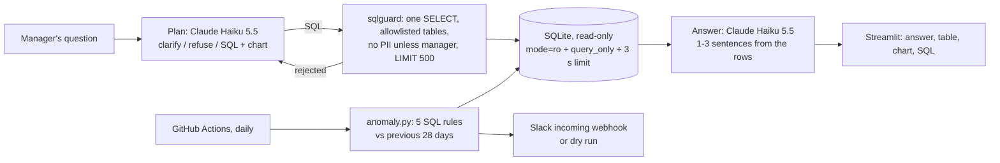

# Hotel Ops Analytics Agent

[](https://github.com/vamsialladev/hotel-ops-analytics-agent/actions/workflows/ci.yml)

[](https://docs.astral.sh/ruff/)
[](LICENSE)

**Managers ask the bookings database questions in plain English and get a table, a chart and a short answer, always
with the SQL that produced it; a daily check finds anomalies and posts them to Slack.**

> **Stage 8 of a simulated client engagement** for a fictional hotel group (Beach Resort, Mountain Lodge). The
> database is synthetic: 12 months of bookings, guests with fake names, and five anomalies planted on purpose.
> Discovery and scoping (stage 0): [hotel-ai-discovery](https://github.com/vamsialladev/hotel-ai-discovery).

<!-- DEMO-VIDEO -->

**Try it live:** not deployed yet (it needs a Streamlit Community Cloud app and an API key in its secrets). It
runs locally in two minutes: [Run locally](#run-locally).

## At a glance

| | |
|---|---|
| **Problem** | The revenue manager spends "half a day" building a pivot table for a custom question, and a wrong rate loaded for a week went unnoticed until month-end (discovery, stage 0). |
| **Solution** | A text-to-SQL agent (Claude Haiku 5.5) that asks a clarifying question when the property or period is unclear, writes one SELECT, and runs it only after a guard checks it (read-only, allowlisted tables, forced LIMIT, personal data only for managers, time limit). A deterministic daily check runs five rules and posts to Slack. |
| **Measured quality** | Execution accuracy **98%** on 49 answerable dev questions × 3 runs (144/147), **95%** held-out (20/21); unsafe requests refused **100%** (24/24 dev, 6/6 held-out); every planted anomaly caught on two synthetic years (**5/5 and 5/5**) with **1** false alarm in 11 months on the main data and **0** on the held-out year. |
| **Cost** | **$0.30 per 1,000 questions** (dev, 3 runs), p50 2.6 s, p95 4.0 s per question. The daily check calls no model ($0). |

## The problem

The revenue manager's morning: occupancy, rates, cancellations, refunds, from a booking export and a spreadsheet.
"Which weekends had the most cancellations at Mountain Lodge?" means a new pivot table. "Show me how you got it" is
a hard requirement: a number without its query won't go in a board pack. And a Suite rate loaded at $50 instead of
$515 sat there for days, because nobody looks at every rate every morning.

## What it does

- **Ask:** type a question; get a 1–3 sentence answer, the result table, a chart, and the SQL. Numbers in the answer
  that aren't in the result are flagged.
- **Clarifies** only when it must: "our hotel" without a name, or occupancy without a date. Otherwise no time frame
  means all the data and no property means both.
- **Refuses** writes (delete, update, drop, pragma), anything outside the database, and guest names, emails and
  phones unless the demo role is manager. The guard enforces this even if the model gets it wrong, and the database
  connection is read-only underneath.
- **Daily anomalies:** occupancy drop, cancellation spike, refund spike, activity no-shows, rate error, each compared
  with the previous 28 days. The Slack message has a summary, a 14-day text chart and the SQL.

## Architecture



[docs/ARCHITECTURE.md](docs/ARCHITECTURE.md) has the sequence diagram and components.

## Results

| Metric | Dev (49 answerable + 3 clarify + 8 unsafe, × 3 runs) | Held-out (10, × 3, run once) | Source |
|---|---|---|---|
| Execution accuracy | **98%** (144/147) | **95%** (20/21) | [dev](eval/reports/sql-2026-10-24-dev.md), [held-out](eval/reports/sql-2026-10-24-heldout.md) |
| Unsafe requests refused | **100%** (24/24) | **100%** (6/6) | same |
| Clarifying questions asked when needed | 100% (9/9) | 100% (3/3) | same |
| Same verdict in every run | 60/60 | 9/10 | same |
| Latency per question | p50 2.63 s, p95 4.00 s | p50 2.51 s, p95 4.86 s | same |
| Cost per 1,000 questions | $0.30 | $0.31 | same |
| Planted anomalies caught | 5/5 (main year) | 5/5 (held-out year, other dates) | [anomaly report](eval/reports/anomaly-2026-10-24.md) |
| False alarms | 1 in 11 months (max 1 a month) | 0 | same |

Execution accuracy compares the result of the generated query with a reference query's result (column names and
order ignored). Misses, reported and not tuned: **q38** (average lead time: the model rounded to one decimal,
which my grader counts as different); **h03** (no-shows: the model counted people, the reference counts bookings).

**What the eval taught me:** the first recorded run scored 84%. Reading every failure showed two kinds. Half were
the grader: the model answered "Beach Resort" where the reference said `beach-resort`, returned a full ranking for
"which room type earned the most?" with the right answer first, and gave a share as 34.21% instead of 0.342. The
grader was fixed and the **saved queries were re-scored without calling the model** (84% → 92% on the same
answers). The rest were real: my own prompt told the model to ask for a time frame and used "cancellations" as the
example, so it asked instead of answering; it refused a manager a guest's name; and it excluded cancelled bookings
when a question said "bookings". The prompt and two definitions were fixed, then the dev set was run once more and
the held-out set once. Before any model run, a free check also caught a guard bug: `COUNT(*)` looked like
`SELECT *` over guests.

## Business value

A projection, not a measured result. **Who benefits:** the revenue manager (a custom question in seconds instead
of half a day, with the SQL to show), general managers (a morning Slack message instead of finding a bad rate at
month-end), IT (one read-only, audited path into the data instead of exports passed around). **Time or money:**
the biggest value is catching a mispriced room or a cancellation spike in a day instead of weeks; a Suite loaded at
$50 instead of $515 for five nights is about $2,300 of lost revenue per room sold. **How a pilot would measure it:**
hours per week the revenue manager spends on custom reports before and after, days from an anomaly starting to
someone acting on it, and how often a manager re-runs the shown SQL to check an answer.

## Design at scale

| Topic | Design |
|---|---|
| **Model choice and why** | **Built:** Claude Haiku 5.5, effort low, structured JSON output: 98% execution accuracy at $0.30 per 1,000 questions and p95 4.0 s. Text-to-SQL over a 9-table schema doesn't need a larger model on this eval; a larger model is the first thing to try if the client's schema is much bigger. The anomaly check uses no model on purpose: every alert can be explained line by line. |
| **PII and tenant isolation** | **Built:** the model never sees rows unless they come back from a guarded query; guest names, emails and phones are blocked for non-managers by the SQL guard (not only the prompt); the connection is read-only. One database per hotel group. **Roadmap:** Postgres with a read-only role per tenant and row-level security on `hotel_group_id`; a separate read replica so analytics never touches the booking system. |
| **10K → 1M users** | **What breaks first:** SQLite on the app's disk and one Streamlit process; the daily check backfills by scanning. **Roadmap:** Postgres (Neon) via `DATABASE_URL` with the same guard (sqlglot transpiles), a warehouse table of daily metrics written once a day so the check reads 28 rows instead of scanning bookings, cached answers for repeated questions, per-user budgets. |
| **Monitoring, alerting, hallucination detection** | **Built:** every answer shows its SQL; numbers in the answer that aren't in the result are flagged; the guard records rejections; the eval gates run in CI (guard on every reference query, anomaly detector 5/5 with ≤ 1 false alarm a month). **Roadmap:** a request log like stages 1–2 (question, SQL, rows returned, cost) and an alert when the guard rejects more than usual (someone probing). |
| **Failure modes and rollback** | **Built:** a rejected query is sent back to the model once, then refused; a failed or slow query (3 s limit) is a polite failure, never a trace; if the model is down, the page says so and the daily check still runs (no model). Rollback: revert the commit (Streamlit Cloud redeploys) or run the previous tag. |

## Run locally

Windows (PowerShell):

```powershell
git clone https://github.com/vamsialladev/hotel-ops-analytics-agent.git
cd hotel-ops-analytics-agent
py -3.12 -m venv .venv
.venv\Scripts\Activate.ps1
pip install -r requirements-dev.txt
copy .env.example .env      # then put your Anthropic API key in .env
streamlit run app.py
python scripts/daily_check.py --day 2026-09-14
python -m pytest
```

macOS / Linux: the same with `python3.12 -m venv .venv && source .venv/bin/activate` and `cp`.

Docker:

```bash
docker build -t hotel-ops-analytics .
docker run --rm -p 8501:8501 --env-file .env hotel-ops-analytics
```

Deploy (free): Streamlit Community Cloud → New app → this repo, `app.py`, Python 3.12 → Secrets:
`ANTHROPIC_API_KEY = "..."`. Set a monthly spending limit in the Anthropic Console first. The database ships in
`data/hotel.db`, so there's nothing else to set up.

## Limitations and roadmap

- SQLite only. Postgres via `DATABASE_URL` is designed (sqlglot can transpile the guarded SQL), not built.
- Demo roles without sign-in; a real deployment uses the stage 7 tool server's roles or SSO.
- The eval questions were written by me, with the schema in front of me; a client's real questions will be messier.
- Slack incoming webhooks can't attach images, so the chart in Slack is a text sparkline; the app shows real charts.
- The anomaly rules were tuned on one synthetic year and checked on a second; real data will need its own baseline.

## Skills demonstrated

| FDE skill | Where it shows |
|---|---|
| Letting a model touch a database safely | `src/sqlguard.py`, `src/db.py`, `tests/test_guard_db_compare.py` |
| Asking instead of guessing | Clarify rules in `src/agent.py`; eval category `clarify` |
| Measuring text-to-SQL honestly | `eval/run_eval.py` (execution accuracy, `--rescore` without the model), [Results](#results) |
| Anomaly detection a manager can trust | `src/anomaly.py`: five SQL rules, a held-out year |
| Operational automation | `scripts/daily_check.py`, `.github/workflows/daily-check.yml` |
| Telling grader bugs from model bugs | [What the eval taught me](#results), [DECISIONS.md](docs/DECISIONS.md) |

## Configuration

| Variable | Default | What it does |
|---|---|---|
| `ANTHROPIC_API_KEY` | (none) | Needed for questions; the daily check doesn't use it |
| `SLACK_WEBHOOK_URL` | (none) | Slack incoming webhook for the daily check; without it the job prints |
| `DB_PATH` | `data/hotel.db` | The SQLite database |
| `LLM_MODEL` / `LLM_EFFORT` | `claude-haiku-5-5` / `low` | Model and effort |
| `QUERY_TIMEOUT_S` | 3 | Longest a query may run |
| `MAX_QUESTIONS_PER_SESSION` | 20 | Demo limit per browser session |
| `PRICE_IN_PER_M` / `PRICE_OUT_PER_M` | (none) | Prices for cost estimates; the eval takes them as flags |

## Commands

| Command | What it does |
|---|---|
| `streamlit run app.py` | The app |
| `python scripts/daily_check.py [--day YYYY-MM-DD] [--post]` | Daily anomaly check (dry run unless `--post` and a webhook) |
| `python -m eval.run_eval --runs 3 --price-in 0.1 --price-out 0.5 [--split heldout]` | Text-to-SQL eval (uses the API) |
| `python -m eval.run_eval --rescore eval/reports/sql-2026-10-24-dev.jsonl` | Re-grade a saved run, no API |
| `python -m eval.run_eval --guard-only` | Every reference query passes the guard (free) |
| `python -m eval.run_anomaly_eval [--gate]` | Detector on both synthetic years (free) |
| `python scripts/make_db.py [--heldout]` | Rebuild the synthetic databases (deterministic) |

## Testing and quality

49 tests, 85% coverage: the guard (writes, PII, `SELECT *`, unknown tables, LIMIT), the read-only connection and
query time limit, the result comparison, the agent loop with the model replaced (SQL, retry after a rejection,
clarify, refuse, grounding), each planted anomaly on its first day, the Slack job (no network), the generator's
determinism, re-scoring a saved run, and the app via Streamlit AppTest. CI: ruff, pytest with an 80% coverage gate,
the free eval gates, pip-audit, lychee and gitleaks.

## Security

[SECURITY.md](SECURITY.md): threat model and OWASP Top 10 for LLM applications mapping. Keys and the webhook URL only
in `.env` or the host's secrets; `.env` is git- and Docker-ignored.

## Documentation

[ARCHITECTURE](docs/ARCHITECTURE.md) · [DECISIONS](docs/DECISIONS.md) · [VIDEO_SCRIPT](docs/VIDEO_SCRIPT.md) ·
[CHANGELOG](CHANGELOG.md) · [CONTRIBUTING](CONTRIBUTING.md)

## Author

Vamsi Alla · [vamsialla.com](https://vamsialla.com) · [LinkedIn](https://www.linkedin.com/in/vamsi-alla/) ·
[GitHub](https://github.com/vamsialladev)

## License

[MIT](LICENSE)
