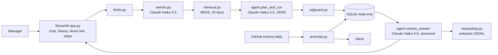
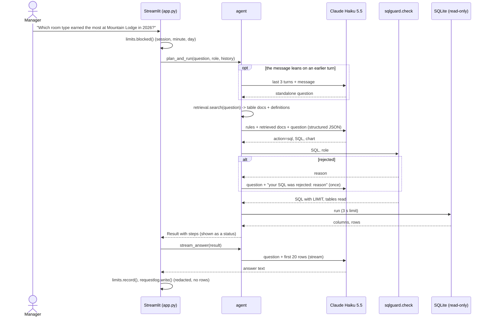

# Architecture

## System

## A question, start to finish

## Components

| Module | Job |
|---|---|
| `src/schema.py` | Tables, join partners, personal-data columns, metric definitions as retrievable docs |
| `src/retrieval.py` | BM25 over the schema docs; the docs the plan prompt is built from |
| `src/rewrite.py` | Follow-up → standalone question (one short model call, only when it looks like a follow-up) |
| `src/agent.py` | Plan → guard → run (with steps), then the streamed answer and the grounding check |
| `src/sqlguard.py` | Parses with sqlglot and enforces the rules; returns the SQL to run |
| `src/db.py` | Read-only connection and query time limit |
| `src/limits.py` | Per-session, per-minute and daily (questions and cost) limits, checked before any model call |
| `src/requestlog.py` / `src/pii.py` | One redacted JSON line per question; stage 1's redaction |
| `src/share.py` | Read-only share links (conversation inside the URL, personal data removed) |
| `src/suggest.py` | Suggested next questions from the tables the SQL read (no model call) |
| `src/compare.py` | Execution accuracy for the eval |
| `src/anomaly.py` | Five SQL rules, backfill, scoring against planted anomalies |
| `scripts/daily_check.py` | The daily job: detect, format, post to Slack or print |
| `scripts/make_db.py` | The synthetic databases (seeds 42 and 7) |
| `app.py` | Ask (chat), Daily anomalies, How it works, the shared-conversation view |

## Data

`data/hotel.db` (seed 42) is what the app, the eval and CI use; `data/hotel_heldout.db` (seed 7) only tests the
detector. `*.planted.json` lists each year's planted anomalies; the detector never reads them.

Tables: properties, rooms, guests (full_name, email, phone are personal data), rates, bookings, activities,
activity_bookings, refunds, feedback.

## Scaling path

1. Postgres (Neon) via `DATABASE_URL`, a read-only role, and the same guard (sqlglot transpiles to Postgres).
2. A daily-metrics table written once a day, so the anomaly check reads 28 rows instead of scanning bookings.
3. Limits and the request log in a shared store (Postgres) instead of files, so they survive restarts and
   several app replicas.
4. For a schema with hundreds of tables: embeddings next to BM25 for the schema docs, and a larger model for the
   plan step if the eval says so.
