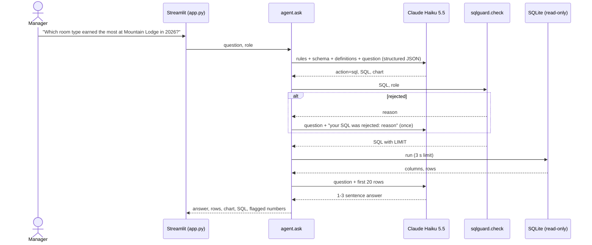

# Architecture

## A question, start to finish

## Components

| Module | Job |
|---|---|
| `src/schema.py` | Tables, columns, personal-data columns, metric definitions; what the model is told |
| `src/agent.py` | Plan → guard → run → answer; one retry after a rejection |
| `src/sqlguard.py` | Parses with sqlglot and enforces the rules; returns the SQL to run |
| `src/db.py` | Read-only connection and query time limit |
| `src/compare.py` | Execution accuracy for the eval |
| `src/anomaly.py` | Five SQL rules, backfill, scoring against planted anomalies |
| `scripts/daily_check.py` | The daily job: detect, format, post to Slack or print |
| `scripts/make_db.py` | The synthetic databases (seeds 42 and 7) |
| `app.py` | Ask, Daily anomalies, How it works |

## Data

`data/hotel.db` (seed 42) is what the app, the eval and CI use; `data/hotel_heldout.db` (seed 7) only tests the
detector. `*.planted.json` lists each year's planted anomalies; the detector never reads them.

Tables: properties, rooms, guests (full_name, email, phone are personal data), rates, bookings, activities,
activity_bookings, refunds, feedback.
